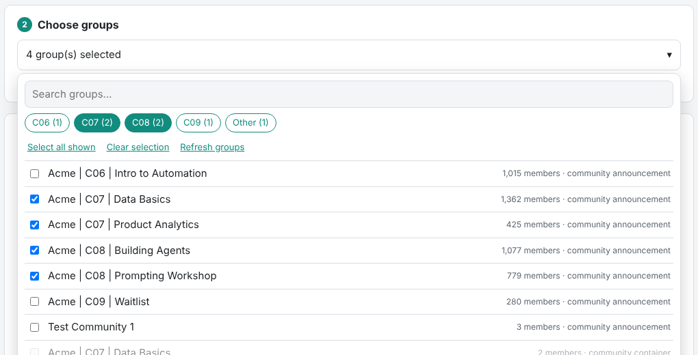
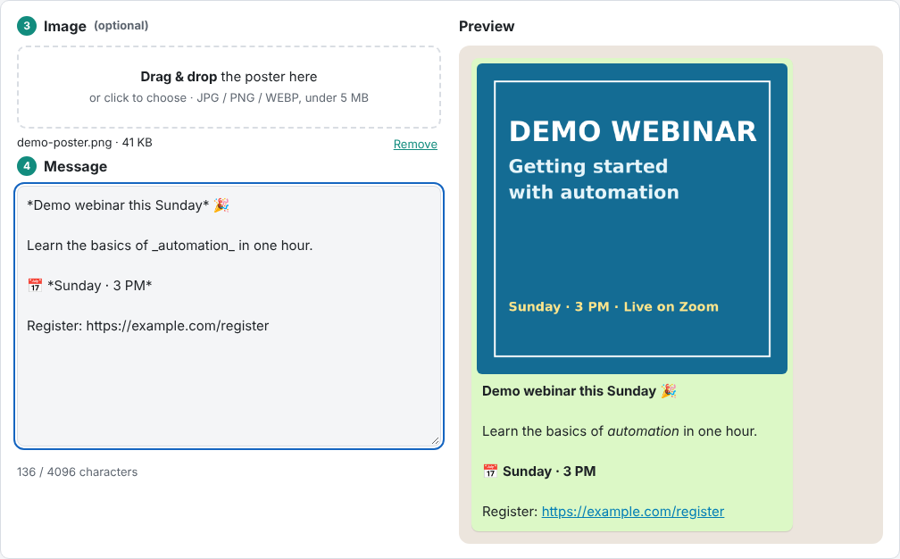
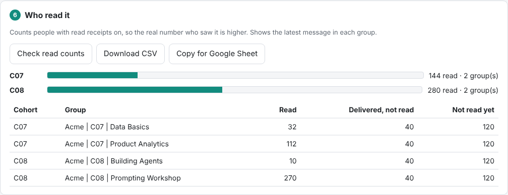

# WhatsApp Broadcast Panel

Send one announcement (text and an optional image) to many WhatsApp groups **that you manage**, from your own computer, and see how many people read it. It's free and open source, and there are no commands to type.



> **Unofficial software, so read this first.** This project uses [whatsapp-web.js](https://github.com/pedroslopez/whatsapp-web.js), which controls WhatsApp Web in a browser. It is **not** made, approved or supported by WhatsApp or Meta. WhatsApp does not allow unofficial clients, and **numbers that use them can be banned**. Use it only on groups where you are an admin and members expect your announcements. Never use it for spam or unsolicited messages, and follow the laws that apply to you. For approved business messaging, use the official [WhatsApp Business Platform](https://business.whatsapp.com/products/business-platform).

## What it does

| | |
|---|---|
| **Link your WhatsApp** | Scan a QR code (WhatsApp → Linked devices → Link a device). Switch numbers anytime; the old login is kept. |
| **Choose groups** | Search, tick-boxes, and one-click buttons per cohort (detected from names like `Acme \| C07 \| …`). Groups you can't post to are greyed out. |
| **Add an image** | Drag and drop. WEBP is converted to JPG so it never arrives as a sticker. |
| **Write the message** | Live WhatsApp-style preview with `*bold*`, `_italic_`, `~strike~` and links. |
| **Send safely** | Test send to one group, a review screen, and `SEND <number>` typed to confirm. Random pauses between groups, stop on the first error, and groups that already got the same message are skipped. |
| **See results** | Live progress (sent, delivered, failed), then **read counts** per group and per cohort, as CSV or ready to paste into a spreadsheet. |
| **History** | Every send, with time, message, image and results. |

<p>


</p>

## Privacy: everything stays on your computer
- The panel is a small web app that runs **on your computer only**. It listens on `127.0.0.1`, and every request needs a secret key kept in `.panel-token`.
- Your WhatsApp login is stored in `.wwebjs_auth/` **on your computer**. Nothing is uploaded, and there's no server, account or tracking.
- **Never share the `.wwebjs_auth` folder:** it is a full login to your WhatsApp. `.gitignore` keeps it, and all your group lists, messages, images and logs, out of git.

## Install

**Windows**
1. Install **Node.js LTS** from [nodejs.org](https://nodejs.org).
2. Download this project (**Code → Download ZIP**) and extract it.
3. Double-click **`Setup.bat`** (once).
4. Double-click **`Start WhatsApp Panel.bat`** whenever you want to use it.

**Mac / Linux**
```bash
npm install
npx puppeteer browsers install chrome
npm start            # opens http://localhost:3939 in your browser
```

When it starts, keep the terminal window open. A Chrome window with WhatsApp Web opens too: leave it (minimising is fine) and don't click in it.

Step-by-step instructions with screenshots are in [docs/USER-GUIDE.md](docs/USER-GUIDE.md).

## Settings (optional environment variables)

| Variable | Default | What it does |
|---|---|---|
| `PANEL_PORT` | `3939` | Port of the local web page |
| `PANEL_SYNC_SECONDS` | `60` | Wait after connecting before reading groups (bigger accounts may need more) |
| `HEADLESS` | off | Set to `1` to hide the WhatsApp Chrome window (some accounts only connect reliably with it visible) |
| `NO_BROWSER` | off | Set to `1` to not open the browser automatically |

## Command line (optional)
Everything the panel does is also available as commands:
```bash
node send-to-groups.js                 # list groups, writes targets-available.txt
node send-to-groups.js send --dry-run  # preview a send (targets.txt + message.txt [+ image.jpg])
node send-to-groups.js send --targets targets-1.txt --message message-1.txt --image poster.jpg --gap 120
node send-to-groups.js report          # read counts for the latest message in each group
node send-to-groups.js online          # stay connected 5 min so phones can fetch message keys
node link.js                           # link or check the number in a visible window
node inventory.js                      # read-only export of all groups to groups.csv
```

## Limits and good practice
- **At most 30 groups per send.** Use the Safe or Normal speed for large sends, and keep daily volume modest.
- **One computer should send a given announcement.** The "already sent" memory (`send-log.csv`) is stored per computer.
- **WhatsApp Communities:** you post to a Community's **Announcements** group (you must be an admin there), not to the Community itself.
- **Read counts** include only people with read receipts turned on, so the real number who saw a message is higher.
- **Phones showing "Waiting for this message":** keep the panel connected a few minutes after sending, so phones can fetch the decryption keys.

## Troubleshooting

| You see | Try |
|---|---|
| Stuck on Loading / Syncing | Wait (large accounts take minutes), then click **Reconnect** |
| A QR code appears unexpectedly | The phone unlinked this computer: scan again |
| `Could not find Chrome` | Run `Setup.bat` again, or `npx puppeteer browsers install chrome` |
| A group shows **Failed** | Check that group on the phone, then click **Retry failed groups** |

## Why a vendored copy of whatsapp-web.js?
WhatsApp Web changed in 2026 in ways that break the latest npm release (1.34.7): `getChats()` fails with `r: r`, and image sending fails with *"Data passed to getter must include an id property"*. The `vendor/` folder holds the official code at commit `064a3d5`, which fixes both, plus one small, marked local patch for unreliable connections. Details are in [vendor/README.md](vendor/README.md). When a fixed version is published on npm, switch back to it.

## Development
```bash
npm install
npm test     # 67 tests with a simulated WhatsApp, so nothing is sent
```

| Path | What it is |
|---|---|
| `panel/server.js` | Local web server, WhatsApp connection, API and live updates |
| `panel/public/` | The page: plain HTML, CSS and JavaScript, no build step |
| `send-to-groups.js` | Sending engine (planning, safety checks, sending, logging, read counts) and the command line |
| `lib.js` | Group inventory, Community roles, CSV helpers |
| `vendor/` | whatsapp-web.js (Apache-2.0) |

Contributions are welcome. See [CONTRIBUTING.md](CONTRIBUTING.md).

## License
MIT, see [LICENSE](LICENSE). The bundled whatsapp-web.js is Apache-2.0. Not affiliated with WhatsApp or Meta.
