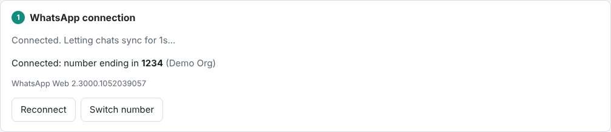
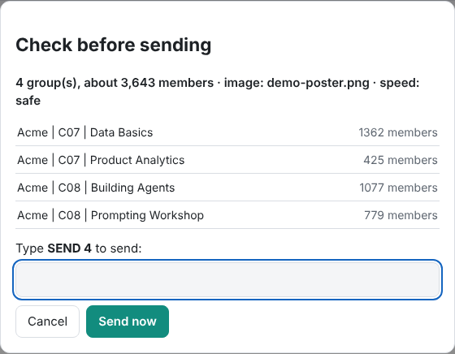
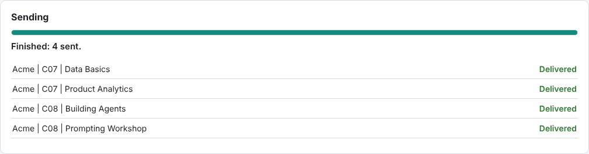

# User guide

Use this on groups **you manage**, where members expect your announcements. WhatsApp can ban numbers that use unofficial tools, so keep volume modest and never spam.

## 1. Install (once, about 10 minutes)
1. Install **Node.js LTS** from https://nodejs.org (click Next through the installer).
2. Download the project (**Code → Download ZIP**) and extract it, for example to your Desktop.
3. Open the folder and double-click **`Setup.bat`**. Wait for "Setup finished".

## 2. Start the panel
Double-click **`Start WhatsApp Panel.bat`**. Three things appear:
- **a black window:** keep it open, because closing it stops the panel
- **your browser** with the panel
- **a Chrome window with WhatsApp Web:** leave it (minimise it) and don't click in it

## 3. Link your WhatsApp (first time only)
A QR code appears. On your phone: **WhatsApp → Settings → Linked devices → Link a device**, then scan it.

Wait until the top right says **Connected**. The first time can take a few minutes while chats sync.

## 4. Choose groups
Open the dropdown, search or tick groups, or click a cohort button to select all its groups. Greyed-out groups can't receive messages from your number (for example, a Community itself, or an admin-only group where you're not an admin).

## 5. Add the image and message
Drag the poster into the box (optional), then type the message. The preview shows how it will look in WhatsApp.

## 6. Test, then send
1. Under **Send a test first to**, pick a small test group and click **Send test**. Check it on your phone.
2. Choose a speed. **Safe** (about 2 minutes between groups) is best for big sends.
3. Click **Review & send**, check the list, and type the `SEND <number>` shown.

Progress updates live. If a group fails, sending stops. Check that group on the phone, then click **Retry failed groups**; groups that already got the message are skipped.

## 7. See who read it
A few hours later, click **Check read counts**. You get numbers per cohort and per group, which you can **Download CSV** or **Copy for Google Sheet**.

## Good to know
- Only people with read receipts turned on are counted as "read".
- Only one computer should send a given announcement, because each computer remembers what it sent.
- **Switch number** keeps the old login (renamed) and shows a new QR code for the other phone.
- Never share the `.wwebjs_auth` folder: it is a full login to your WhatsApp.
